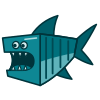
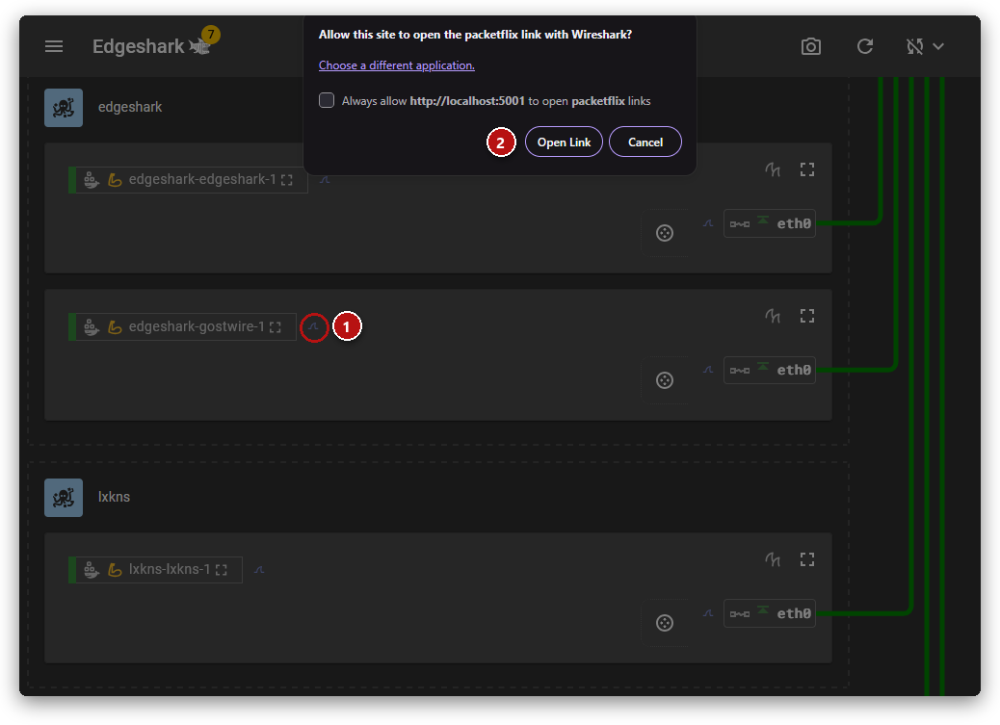
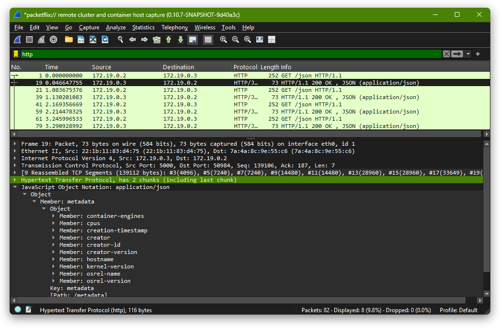
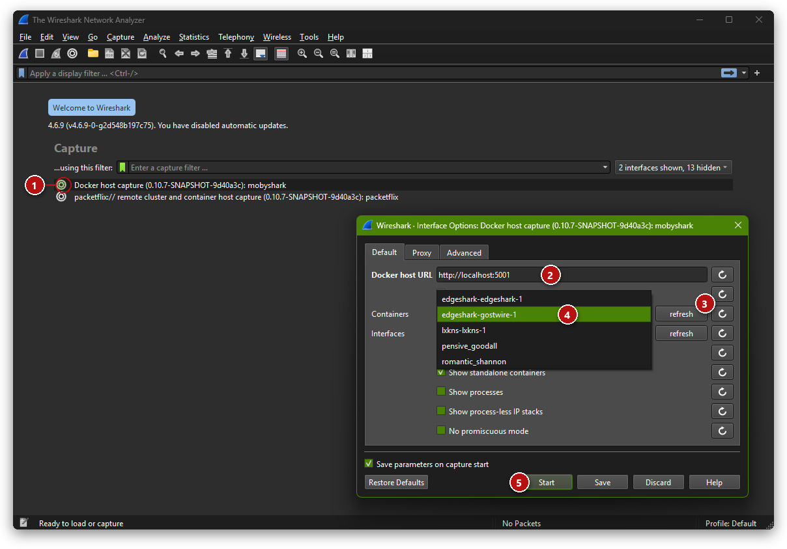
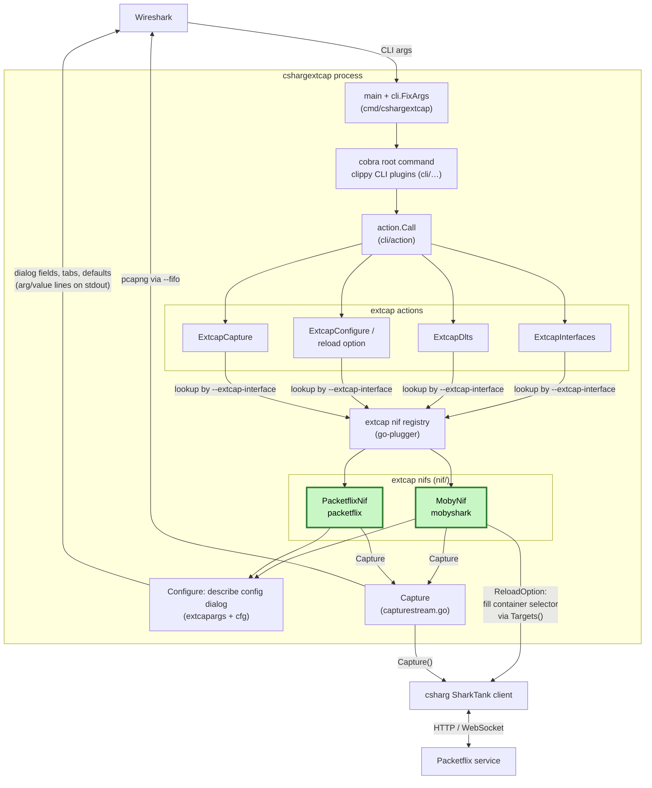

[](https://github.com/siemens)
[](https://github.com/industrial-edge)
[](https://github.com/siemens/edgeshark)

# Containershark Extcap Plugin for Wireshark

[](https://pkg.go.dev/github.com/siemens/cshargextcap)
[](https://img.shields.io/github/license/siemens/cshargextcap)


Take a deep dive into your container host virtual networking, even if it's in a
remote location. No fiddling with special containers and juggling error-prone
CLI Docker commands. Simply click on a "fin" capture button inside one of the
containers in Ghostwire's web UI to start a Wireshark live capture session:



Confirm and we're live capturing.



## What You See Is What You Get

- Capture network traffic _live_ from your containers (and pods), straight into
  your Desktop Wireshark on _Linux_ and _Windows_.

- Capture from any container _without_ preparing or modifying it for capturing.
  Just go capturing.

- Supports stand-alone container hosts, including the Siemens Industrial Edge.

- Remotely capture not only from containers, but also from the container host
  itself, process-less network namespaces, et cetera.

- this Wireshark plugin can be built for Windows 64bit (x86, ARM) as well as Linux
  64bit (x86, ARM). Currently, we support the .apk, .deb, and .rpm package
  formats on Linux.

## Installation

- **Linux**: 
  - **Alpine**, **Debian**/**Ubuntu**, **Fedora**/**AlmaLinux** (and other
    RHEL-compatible distros): head over to our
    [releases](https://github.com/siemens/cshargextcap/releases/latest) page and
    download the package matching your CPU architecture (amd64 or arm64) and
    distro package format. Install the downloaded package as usual.
  - **Arch**:
    1. download `PKGBUILD` into a preferably clean directory:
       ```bash
       wget https://raw.githubusercontent.com/siemens/cshargextcap/main/packaging/aur/PKGBUILD
       ```
    2. `makepkg -s -r -c` in the directory you've downloaded `PKGBUILD` into.
    3. either install only the excapt plugin, or additionally the Wireshark QT
       desktop integration:
       ```bash
       # plugin only for tshark usage, without desktop Wireshark dependency
       pacman -U cshargextcap-git-cli*.zst
       # with desktop integration
       pacman -U cshargextcap-git-*.zst
       ```
    4. You can later update to new releases without the need to download the
       `PKGBUILD` file again, as it will automatically build and install from
       the latest release.

- **macOS**: install [Wireshark](https://www.wireshark.org/download.html) first,
  then run in Terminal:
  ```bash
  /bin/bash -c "$(curl -fsSL https://github.com/siemens/cshargextcap/releases/latest/download/macos-install-handler.sh)"
  ```
  This installs the latest release for your user, without admin rights:
  - the `cshargextcap` plugin into Wireshark's personal extcap folder
    `~/.local/lib/wireshark/extcap`,
  - the `packetflix:` URL handler into `~/Applications/packetflix-handler.app`.

  Run the same command again to upgrade. It also replaces older installations
  that put the plugin into `Wireshark.app` and the handler into
  `/Applications`. Restart Wireshark afterwards if it was running.

  To uninstall, delete `~/Applications/packetflix-handler.app` and
  `~/.local/lib/wireshark/extcap/cshargextcap`.

- **Windows**: head over to our
  [releases](https://github.com/siemens/cshargextcap/releases/latest) page and
  download the installer `cshargextcap_*_windows_amd64_setup.exe` (or
  `…_arm64_setup.exe` for Windows on Arm) and run it; it needs administrator
  rights and asks you to accept the license before installing. The installer
  automatically locates your Wireshark installation and also registers the
  `packetflix:` URL handler. For unattended installation, run it with `/S`,
  optionally with `/D=<Wireshark extcap folder>`. Uninstall via Windows'
  "Apps & features".

See below for the [Quick Start](#quick-start).

## Edgeshark Project

The Containershark extcap plugin is part of the "Edgeshark" project that
consist of several repositories:
- [Edgeshark Hub repository](https://github.com/siemens/edgeshark) with
  Edgeshark Industrial Edge App.
- [Ghostwire discovery service](https://github.com/siemens/ghostwire)
- [Packetflix packet streaming service](https://github.com/siemens/packetflix)
- **Containershark Extcap plugin for Wireshark**
- [csharg (CLI)](https://github.com/siemens/csharg)
- [mobydig](https://github.com/siemens/mobydig)
- [ieddata](https://github.com/siemens/ieddata)

## Quick Start

Please deploy the [G(h)ostwire discovery
service](https://github.com/siemens/ghostwire) and [Packetflix packet streaming
service](https://github.com/siemens/packetflix) on your Docker host.

Then install this plugin: on Windows download and install the cshargextcap
installer artifact. On Linux, download and install the cshargextcap package for
your distribution (apk, deb, or rpm).

To build the installation files yourself, run `make dist-build` in the base
directory of this repository; they end up in the `dist/` directory.
`make dist-test` installs the Linux packages in distro containers to check them,
and `make dist` does both. Building the Windows installer needs `makensis`,
which the dev container provides; without it, Docker is used instead.

Now fire up Wireshark. If the installation went through correctly, Wireshark now
should show two new "interfaces", as shown below: 



It's as easy as this:

1. click the ⚙ _gear icon_ next to the network interface named "Docker host
   capture".
2. enter your Docker host's IP address or DNS name, as well as port `:5001` into
   the field "Docker host URL".
3. click the _refresh_ button to get the list of available pods (and more...).
4. pick your container.
5. click the _Start_ button.

...and your live capture starts immediately.

> **🛈** Wireshark creates the UI for our capture plugin and unfortunately we're
> therefore (quite) limited to what Wireshark has on offer. Please don't create
> UI/UX feature requests as we don't have any control over Wireshark's UI – with
> the exception of our _own_ bugs: please create issues for them in this
> project's issue tracker.

Please find more details in our [csharg Extcap ⚙ Plugin Manual](docs/manual.md).

Finally, there's also some technical background information in our
[csharg ⚙ Plugin Technical Details](docs/technical.md).

## Architecture

```mermaid
flowchart LR
    subgraph desktop["Desktop"]
        browser["Web browser<br/>(Ghostwire UI)"]
        handler["packetflix: URL handler<br/>(.desktop / registry / macOS app)"]
        wireshark["Wireshark"]
        extcap["cshargextcap<br/>«extcap plugin»"]
    end
    subgraph host["Container host"]
        packetflix["Packetflix<br/>«service»"]
        ghostwire["Ghostwire<br/>«service»"]
        containers["containers,<br/>network namespaces"]
    end

    browser -- "click fin:<br/>packetflix:… URL" --> handler
    handler -- "wireshark -k -i packetflix<br/>-o extcap.packetflix.url:…" --> wireshark
    wireshark -- "extcap CLI<br/>(interfaces, config, dlts, capture)" --> extcap
    extcap -- "packets via fifo" --> wireshark
    extcap -- "HTTP: discovery" --> packetflix
    extcap -- "WebSocket: capture stream" --> packetflix
    packetflix -- "discovery" --> ghostwire
    ghostwire -. "discovers" .-> containers
    packetflix -. "captures from" .-> containers
```



- **cshargextcap** is a Wireshark [extcap](https://www.wireshark.org/docs/man-pages/extcap.html)
  plugin: Wireshark runs it as a separate process for each step (list
  interfaces, configuration UI, data link types, capture). It offers two
  interfaces: "Docker host capture" (`mobyshark`) for http(s): URLs and
  `packetflix` for `packetflix:` URLs.
- **Packetflix** runs on the container host and is the only service the plugin
  talks to: it forwards discovery requests to **Ghostwire** and streams captured
  packets over a WebSocket connection. The plugin writes these packets into the
  fifo Wireshark reads from.
- The **`packetflix:` URL handler** hands capture links from Ghostwire's web UI
  over to Wireshark, which starts capturing immediately using the `packetflix`
  interface.

### Inside cshargextcap



- **Short-lived processes:** Wireshark starts a new plugin process for every
  extcap request. [main.go](cmd/cshargextcap/main.go) first runs
  [`cli.FixArgs`](cli/fixer.go), which merges the `--flag true` style that
  Wireshark sometimes passes into `--flag=true`. A [cobra](https://github.com/spf13/cobra)
  root command then parses the arguments. The packages in [cli/](cli) register
  their own CLI flags through `clippy` plugins: debug logging, proxy, timeouts,
  TLS verification, capture target, and Wireshark-specific flags such as
  `--fifo` and `--extcap-reload-option`.
- **Action dispatch:** [`action.Call`](cli/action/action.go) chooses one of the
  mutually exclusive extcap actions (`--extcap-interfaces`, `--extcap-dlts`,
  `--extcap-config`, `--capture`). It then calls the matching `Extcap…`
  function in the root package, which writes extcap's line-based output to
  stdout or starts a capture.
- **Pluggable interfaces:** each extcap network interface implements
  [`ExtcapNifActions`](extcap_nif.go) and registers itself through
  [go-plugger](https://github.com/thediveo/go-plugger) when the package is
  loaded. The actions look up the interface named by `--extcap-interface` in
  this registry. Two interfaces exist today:
  - [`MobyNif`](nif/moby.go) (`mobyshark`) connects to an http(s) Docker host
    URL. It provides the full configuration UI and reloads the container list
    from the capture service on request.
  - [`PacketflixNif`](nif/packetflix.go) (`packetflix`) turns a `packetflix:`
    URL into the service base URL plus the capture target, interfaces, and
    filter. It then sets the matching CLI flags so that capturing follows the
    same path as `mobyshark`.
- **Configuration UI:** [extcapargs/](extcapargs) builds and prints extcap
  `arg {…}` and `value {…}` lines. [cfg/](cfg) defines the argument numbers
  and the standard, advanced, and proxy tabs that the interfaces share.
  Wireshark builds its configuration dialog from these lines.
- **Discovery:** reloading the container list calls `Targets()` on a
  [csharg](https://github.com/siemens/csharg) `SharkTank` client. Each target
  is stored as URL-escaped JSON in the `--container` value. That value is
  later used to fill in the interface list and to start the capture.
- **Capture:** [`Capture`](capturestream.go) opens Wireshark's `--fifo` for
  writing. It then has csharg stream packets from Packetflix over a WebSocket
  straight into that fifo. When Wireshark stops a capture it sends
  `SIGINT`/`SIGTERM`. The first signal stops the stream cleanly, a second one
  aborts the plugin immediately.

# Contributing

Please see [CONTRIBUTING.md](CONTRIBUTING.md).

## License and Copyright

(c) Siemens AG 2023-2026

[SPDX-License-Identifier: MIT](LICENSE)
