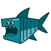
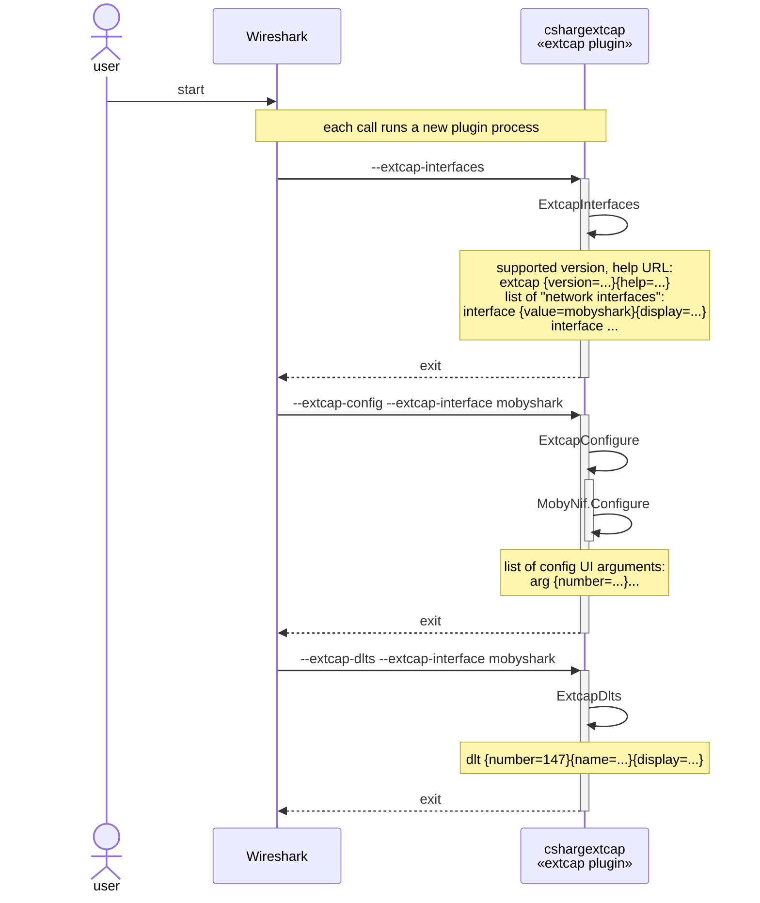
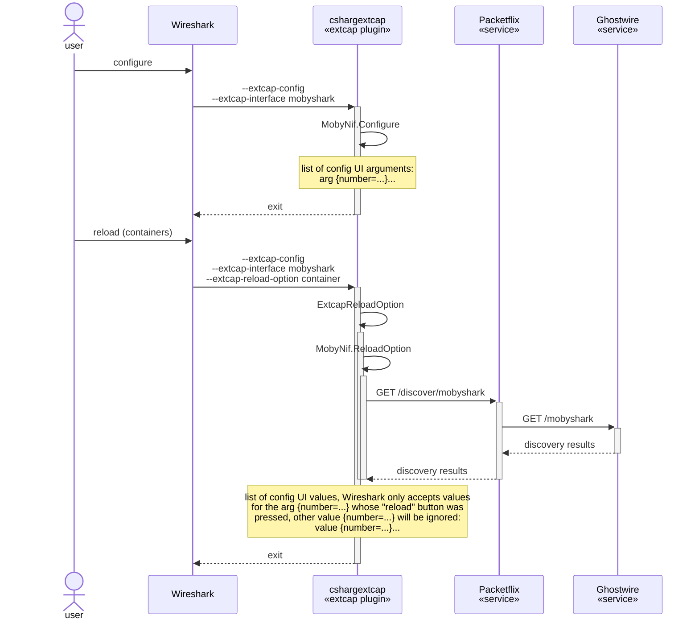
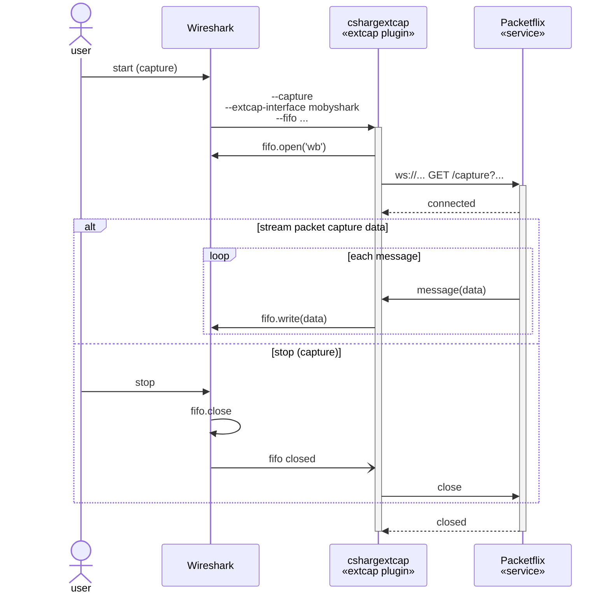

# Containershark ⚙ Plugin Technical Details

Please️ note that function names such as `ExtcapConfigure` are high-level
functions of the extcap pluging. These then rely on
[csharg](https://github.com/siemens/csharg) library functions for the dirty
work.

## Wireshark Startup

When Wireshark starts, it looks into its `extcap` directories (system-wide and
per user) searching for plugin executables, which it then starts one after
another in order to gather information:

- the network interfaces provided by these extcap plugins,
- the UI configuration parameters used by these plugins,
- and finally the data link layer encapsulation used by these network interfaces.

The important takeaway here is that extcap plugins are very "_RESTless_" because
Wireshark calls them _multiple_ times. This does not exactly improve performance
due to having to initialize multiple times. However, the compiled code and the
Go runtime do a well performing job here in our experience, so this issue is
mitigated to a good extend.

## Interface Configuration

The user clicks on the gear icon next to an extcap plugin network interface.
And yes, Wireshark asks for the UI configuration parameters _again_. Then, the
user presses a "reload" button in order to update, for instance, the list of
containers.

To simplify single-host service configuration the plugin only talks to the
Packetflix service on a standalone container host, and Packetflix implements a
forwarding path to reach the associated Ghostwire service instance.

## Capture from Paketflix Service via External Capture Plugin

After all the hassle, let's capture packets. Here's the basic picture – where
we've left out all the complex details about updating the toolbar and statusbar,
and then even more.

